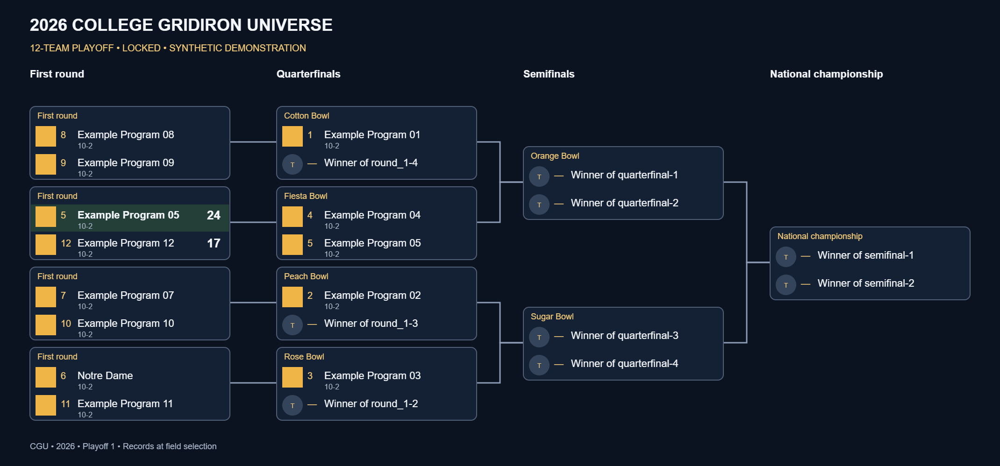
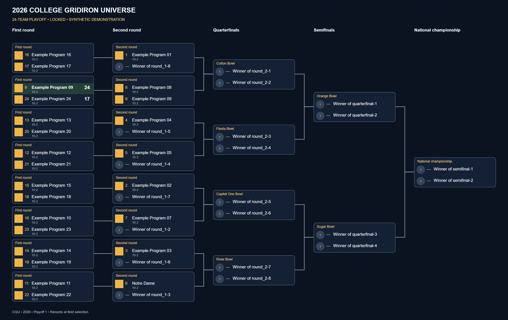

# College Gridiron Universe (CGU)

College Gridiron Universe is a Windows desktop companion for NCAA Football 14
and College Football Revamped dynasties in RPCS3. Keep playing football in NCAA;
use CGU to manage the wider dynasty experience with roster planning, recruiting,
transfers, staff tools, postseason planning, history and guarded save integration.

## Download

[Download the original CGU V1.0.0 installer](https://github.com/who9jj/CGU-Releases/releases/download/cgu-v1.0.0/CGU.Setup.exe)
or [view its release page](https://github.com/who9jj/CGU-Releases/releases/tag/cgu-v1.0.0).

This public repository distributes official production installers and user
documentation. Private UAT builds are distributed separately and are not public
production releases. The original V1.0.0 remains available under its original tag
and filename. No new production version is announced by this documentation.

The original `CGU.Setup.exe` is 1,033,882,220 bytes. Its verified GitHub asset
SHA-256 at the preparation audit is:

```text
b5002d603ec6e53492805023d63069c9f60b1c8b0bb70d35b9608c970bf11584
```

To compare your downloaded file in PowerShell:

```powershell
Get-FileHash -Algorithm SHA256 -LiteralPath '.\CGU.Setup.exe'
```

## Features

- Dynasty import, synchronization and career history.
- Recruiting, transfer portal and roster planning workflows.
- Development Reserve, staff and captain tools.
- Position Change Lab, career projection and dynasty what-if analysis.
- CFP/postseason planning and Championship Rewards.
- Backups, restore, database migration and recovery tools.

Availability and limits depend on the installed release. Read the
[V1 release notes](docs/release-notes-v1.md) and
[known limitations](docs/known-limitations.md) before changing an existing career.

## Requirements and installation

Use a Windows x64 PC capable of running your supported RPCS3/NCAA Football 14 or
College Football Revamped setup, plus a compatible dynasty save. No separate
Python or SQLite installation is needed for the packaged CGU application. The
game, emulator and game files are separate from CGU. Allow room for the installer,
application and complete dynasty backups.

1. Back up the complete existing CGU profile and the NCAA dynasty. For an upgrade,
   follow the [backup, restore and upgrade guide](docs/backup-restore-upgrade.md).
2. Download the installer from the official release page and compare its checksum.
3. Close CGU and RPCS3, then run the installer. Keep an existing installation's
   upgrade destination and retained user data; do not reset a profile to upgrade.
4. Launch College Gridiron Universe and connect the parent RPCS3 `savedata` folder.
5. Select the intended dynasty and Sync. Confirm the correct school/career before
   using any action that changes NCAA data.

For native changes, save and exit the dynasty and close RPCS3 first. Use CGU's
supported preview/confirmation workflow, then reload the dynasty in NCAA and
verify the result. Read-only analysis does not itself publish native changes.

## Documentation

- [Quick Start](docs/quick-start.md)
- [User Guide](docs/user-guide.md)
- [Backup, Restore and Upgrade](docs/backup-restore-upgrade.md)
- [Known Limitations](docs/known-limitations.md)
- [Community Overview](docs/community-overview.md)
- [V1 Release Notes](docs/release-notes-v1.md)

## CGU presentation previews

These retained CGU screenshots show synthetic playoff demonstrations. They
illustrate the product's existing presentation; they are not screenshots of a
newly released installer or evidence of completed native gameplay.





## Version history and support

| Public version | Release |
| --- | --- |
| Original V1.0.0 | [cgu-v1.0.0](https://github.com/who9jj/CGU-Releases/releases/tag/cgu-v1.0.0) |

[Browse official releases](https://github.com/who9jj/CGU-Releases/releases).
Historical guides retain the terminology and limits of the release they describe.
CGU runs locally with its bundled frontend; a hosted preview is a separate
development surface. Unsupported native operations remain unavailable.

[Report a bug](https://github.com/who9jj/CGU-Releases/issues/new)
with your CGU version, Windows version, the affected feature, reproduction steps,
expected/actual behavior and a sanitized error message. Keep NCAA saves, personal
databases, private profile directories and credentials out of public issues.
